<!-- the panels in assets/ are generated by src/build.py from the same content as luizgodoy.dev.
     edit the data at the bottom of it, run python3 src/build.py, commit assets/. -->

<a href="https://luizgodoy.dev"></a>


<a href="https://luizgodoy.dev/#gig-01"></a>
<a href="https://auroratcg.app"></a>

<a href="https://schemaflow.uk"></a>
<a href="https://plugpal.luizgodoy.dev"></a>

<a href="https://luizgodoy.dev/#gig-05"></a>
<a href="https://luizgodoy.dev/#gig-06"></a>

<a href="https://luizgodoy.dev/#gig-07"></a>
<a href="https://luizgodoy.dev/#gig-08"></a>

<a href="https://github.com/LuizHGodoy/clizin"></a>
<a href="https://github.com/LuizHGodoy/claude-e2e"></a>

<a href="https://luizgodoy.dev/#gig-XX"></a>



<code>/ <a href="https://github.com/LuizHGodoy">github.com/LuizHGodoy</a></code>&nbsp;
<code>/ <a href="https://luizgodoy.dev">luizgodoy.dev</a></code>&nbsp;
<code>/ <a href="https://auroratcg.app">auroratcg.app</a></code>&nbsp;
<code>/ <a href="https://schemaflow.uk">schemaflow.uk</a></code>&nbsp;
<code>/ <a href="https://plugpal.luizgodoy.dev">plugpal.luizgodoy.dev</a></code>

